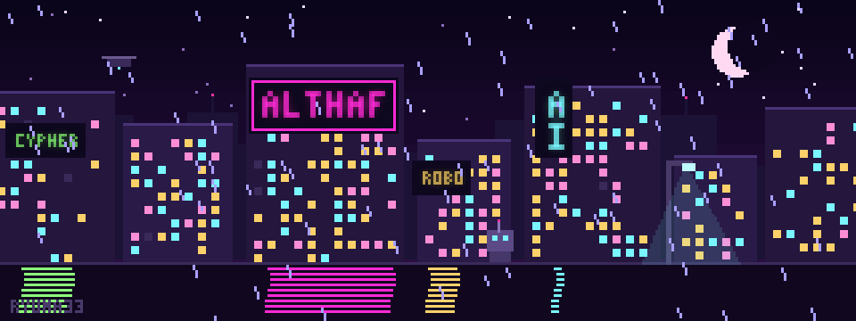
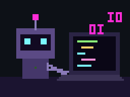

# 👋 Hey there! I'm Althaf Nezam

  

> - 🎓 B.Tech AI & Data Science student @ **VJCET** | Robotics & AI builder
> - ✨ Vibe coder: I love playing with AI tools and turning ideas into working projects fast
> - I like building things that move and think: machines that sense the world, make decisions and act on them. My work sits where hardware meets AI.

---

## 🧠 Currently Working On

- 🛡️ Building **CYPHER**, an AI security surveillance system for IP cameras: weapon, loitering, abandoned-object, fall and camera-tamper detection
- 🤖 Making autonomous robots with **ESP32** and **Arduino**
- 🅿️ Rebuilding **PARK4U**, our camera-based parking app, into a real product
- ✨ **Vibe coding**: experimenting with AI coding tools like **Claude**, **ChatGPT**, **Gemini** and **Cursor**
- 🌱 Leveling up in **AI/ML**, **Python** and **Deep Learning**
- 👯 Open to collaborating on **open-source / web** projects
- 💬 Ask me about **Python**, **Web Dev** and **Machine Learning**

 

---

## 🌐 Connect With Me

  
  
  
  
  
  
  
  

💬 Discord: **ryuma33**

---

## 💻 Tech Stack

### 🧑‍💻 Languages and Web

### 🤖 AI, Machine Learning and Data

     

### 🔌 Embedded and Robotics

### 🌐 Backend, Databases and Deployment

### 🎨 Design

### 🛠️ Tools

### ✨ AI Tools (Vibe Coding)
    

### 🎮 When I'm Not Coding
   

---

## 🚀 Featured Projects

### 🛡️ [CYPHER: AI Security Surveillance System](https://github.com/ryuma33/CYPHER)
An AI-powered, multi-threat surveillance system for IP cameras. It detects **weapons**, **loitering**, **abandoned objects**, **falls** and **camera tampering** in real time, and re-identifies the same person across different cameras. Alerts show up on a live dashboard. The weapon model is trained on a dataset I collected and labelled myself. 
**Tech:** Python, YOLOv8, ByteTrack, OSNet (person re-ID), OpenCV, Streamlit

### 🔥 [Fire-Fighting Robot](https://github.com/ryuma33/Fire-Fighting-Robot)
An autonomous ESP32 robot that finds fires with three flame sensors, drives toward them and puts them out with a pump and a servo-swept nozzle. 
**Tech:** ESP32, Arduino C++, L298N, Servo, Relay

### 🅿️ [PARK4U: Find Parking with Cameras](https://github.com/ryuma33/park4u)
Our school-days app idea, rebuilt as an iPhone-style clickable prototype: a map of camera-monitored spots, navigation, mock card/UPI payment and a parking timer. 
**Tech:** HTML, CSS, JavaScript, Python, OpenCV

### 🔐 [Password Strength Checker](https://github.com/ryuma33/Password-Strength-Checker)
Rates how strong a password is and explains why: entropy, common passwords, leetspeak and keyboard patterns, plus a time-to-crack estimate. Works offline. 
**Tech:** Python, Streamlit, pytest

---

## 📊 GitHub Stats

  
  

  

  <picture>
    <source media="(prefers-color-scheme: dark)" srcset="https://raw.githubusercontent.com/ryuma33/ryuma33/output/github-snake-dark.svg" />
    
  </picture>

